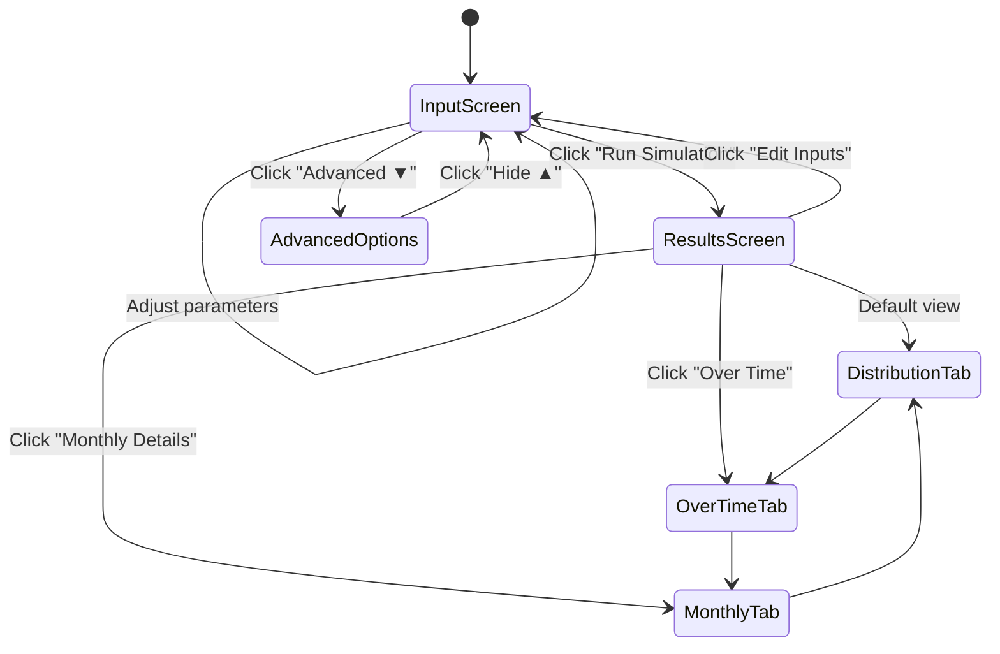
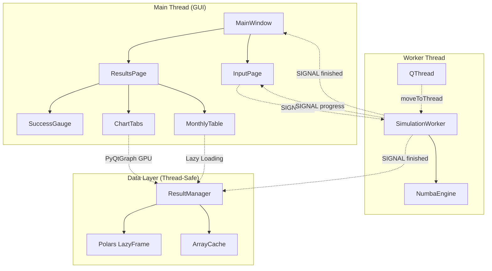
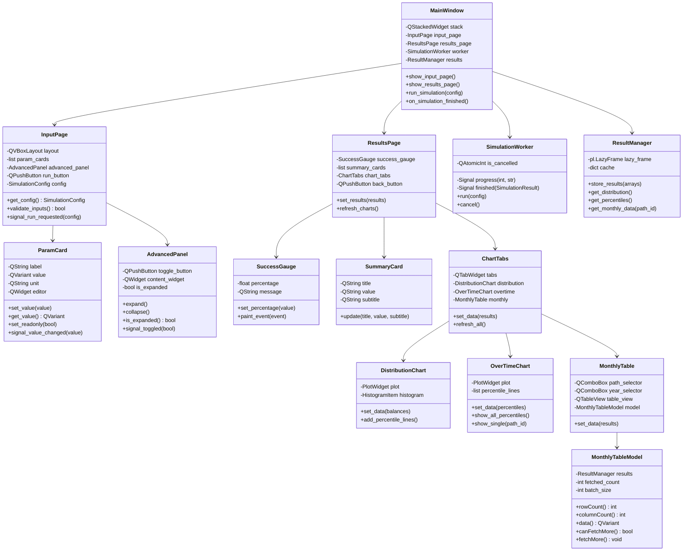
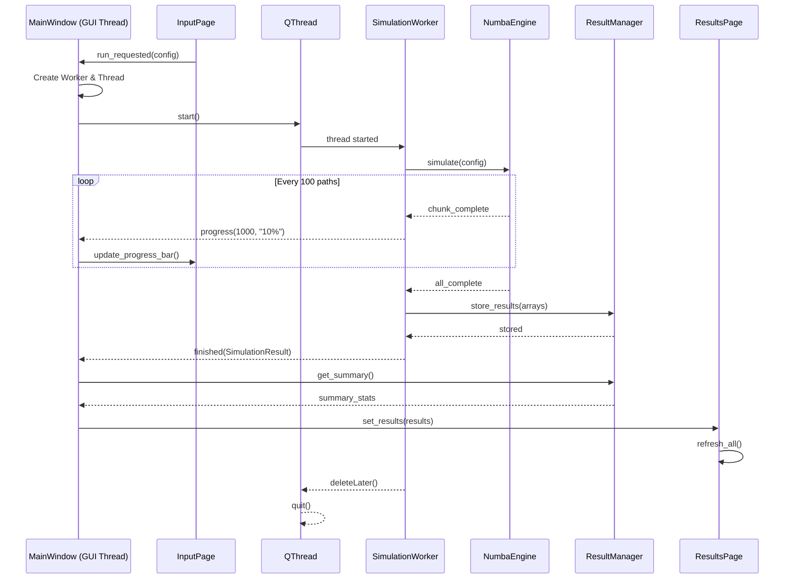

# Portfolio Monte Carlo Simulator - Implementation Plan

**Project:** Monte Carlo Portfolio Simulation with Interactive GUI
**Framework:** PySide6 (Qt for Python)
**Date:** 2025-01-15
**Version:** 1.2 (Dark Mode, No Export)

---

## Table of Contents

1. [Project Overview](#1-project-overview)
2. [Research Findings & Best Practices](#2-research-findings--best-practices)
3. [GUI Design Mockups](#3-gui-design-mockups)
4. [Architecture & Design](#4-architecture--design)
5. [Performance Optimization Strategy](#5-performance-optimization-strategy)
6. [Implementation Plan](#6-implementation-plan)
7. [Component Specifications](#7-component-specifications)
8. [Testing Strategy](#8-testing-strategy)
9. [Dependencies](#9-dependencies)
10. [Installation](#10-installation)
11. [References](#11-references)

---

## 1. Project Overview

### 1.1 Purpose

Build a high-performance Monte Carlo simulation tool for portfolio sustainability analysis with an intuitive GUI. The simulator will:

- Model 10,000+ portfolio paths over 23 years (276 months)
- Display monthly breakdowns of balances, returns, withdrawals, and income
- Provide interactive visualizations (histograms, percentile charts, heatmaps)
- Allow real-time parameter adjustment and recalculation

### 1.2 Key Features

| Feature | Description |
|---------|-------------|
| **Monthly Granularity** | 276 data points per path (23 years × 12 months) |
| **Interactive Charts** | PyQtGraph-powered GPU-accelerated visualizations |
| **Lazy Loading Table** | Display 2.76M+ cells without performance degradation |
| **Real-time Recalculation** | Adjust parameters and re-run simulation instantly |
| **Dark Mode** | Built-in dark theme for reduced eye strain |

### 1.3 Project Structure

```
Monte_Carlo_Simulation/
├── doc/                          # Documentation
│   └── implementation.md         # This file
├── src/                          # Source code
│   ├── __init__.py
│   ├── config.py                 # Pydantic configuration classes
│   ├── simulation.py             # Numba JIT simulation engine
│   ├── results.py                # ResultManager with Polars
│   ├── constants.py              # Colors, fonts, formatting
│   ├── theme.py                  # Dark mode styling (QSS)
│   ├── formatters.py             # Currency, percentage formatting
│   ├── gui/                      # GUI components
│   │   ├── __init__.py
│   │   ├── main_window.py        # Main application window
│   │   ├── pages/                # Page widgets
│   │   │   ├── __init__.py
│   │   │   ├── input_page.py     # Input configuration page
│   │   │   └── results_page.py   # Results display page
│   │   ├── components/           # Reusable UI components
│   │   │   ├── __init__.py
│   │   │   ├── param_card.py     # Parameter input card
│   │   │   ├── summary_card.py   # Summary stat card
│   │   │   ├── success_gauge.py  # Donut chart widget
│   │   │   ├── advanced_panel.py # Expandable options
│   │   │   └── chart_tabs.py     # Chart container
│   │   ├── models/               # Qt models
│   │   │   ├── __init__.py
│   │   │   └── table_model.py    # Lazy loading table model
│   │   └── workers/              # Worker threads
│   │       ├── __init__.py
│   │       └── simulation_worker.py
│   └── utils/                    # Utilities
│       ├── __init__.py
│       └── validators.py         # Input validation
├── tests/                        # Test suite
│   ├── __init__.py
│   ├── test_config.py
│   ├── test_simulation.py
│   ├── test_results.py
│   └── test_gui/
│       ├── __init__.py
│       ├── test_components.py
│       └── test_workers.py
├── requirements.txt              # Production dependencies
├── requirements-dev.txt          # Development dependencies
└── README.md
```

---

## 2. Research Findings & Best Practices

### 2.1 QTableView Performance Optimization

**Key Finding:** QTableView becomes "prohibitively slow" with >3,000 rows without proper optimization.

**Sources:**
- [StackOverflow 31588584](https://stackoverflow.com/questions/31588584) - "PyQt QTableView prohibitively slow when scrolling with large data sets"
- [StackOverflow 4031168](https://stackoverflow.com/questions/4031168) - "QTableView is extremely slow (even for only 3000 rows)"
- [Qt Forum 160263](https://forum.qt.io/topic/160263) - "Optimizing QTableView with large data sets" (Dec 2024)
- [Qt Forum 135874](https://forum.qt.io/topic/135874) - "Suspected excessive calls to QAbstractTableModel.data"

**Best Practices:**

1. **Use QAbstractTableModel, Not QTableWidget**
   - QTableWidget stores all data in memory
   - QAbstractTableModel allows lazy data fetching

2. **Implement fetchMore() and canFetchMore()**
   - Load data incrementally as user scrolls
   - Start with ~100 rows, fetch more on demand
   - Based on Qt's official [Fetch More Example](https://doc.qt.io/qt-6/qtwidgets-itemviews-fetchmore-example.html)

3. **Set uniformRowHeights Property**
   - `table_view.setProperty("uniformRowHeights", True)`
   - Eliminates per-row height calculations
   - Documented in [Qt QTreeView docs](https://doc.qt.io/qt-6/qtreeview.html)

4. **Avoid resizeColumnsToContents()**
   - Queries every row to calculate width
   - Use fixed column widths or manual sizing

5. **Cache Frequently Accessed Data**
   - Store calculated values in model private fields
   - Avoid repeated calculations in data() method
   - Qt Forum confirms data() is called multiple times even for non-visible rows

### 2.2 Threading in PySide6

**Key Finding:** The `moveToThread()` pattern is preferred over subclassing QThread.

**Sources:**
- [Qt Documentation](https://doc.qt.io/qtforpython-6/overviews/qthread.html)
- [StackOverflow 75893608](https://stackoverflow.com/questions/75893608) - "QThread, moveToThread() or another approach?"
- [StackOverflow 50622536](https://stackoverflow.com/questions/50622536) - "moveToThread vs deriving from QThread in Qt"

**Best Practice Pattern:**

```python
# CORRECT: moveToThread pattern
class Worker(QObject):
    progress = Signal(int, str)
    finished = Signal(object)

    def run(self):
        # Work here
        self.progress.emit(50, "Half complete")
        self.finished.emit(result)

# Usage
worker = Worker()
thread = QThread()
worker.moveToThread(thread)

thread.started.connect(worker.run)
worker.finished.connect(thread.quit)
worker.finished.connect(worker.deleteLater)
thread.finished.connect(thread.deleteLater)

thread.start()
```

### 2.3 PyQtGraph vs Matplotlib

**Key Finding:** PyQtGraph is significantly faster than Matplotlib for real-time plotting due to GPU acceleration and Qt-native rendering.

**Sources:**
- [PyQtGraph Official Comparison](https://pyqtgraph.com/is-pyqtgraph-better-than-matplotlib-for-live-plots/)
- [SciPy Proceedings 2023](https://proceedings.scipy.org/articles/gerudo-f2bc6f59-00e) - Performance study showing 75-150x improvement

**Performance Comparison:**

| Operation | Matplotlib | PyQtGraph | Notes |
|-----------|-----------|-----------|-------|
| 1000 points @ 10Hz | ~500ms | ~5ms | 100x faster |
| 4000×4000 image | ~850ms | ~11ms | 77x faster |
| Real-time updates | Poor | Excellent | PyQtGraph designed for this |

### 2.4 Numba JIT Compilation

**Key Finding:** Numba's `@njit(parallel=True)` can provide 100-1000x speedup for Python loops over pure Python, and 2-10x over NumPy for certain operations.

**Sources:**
- [Numba Documentation](https://numba.pydata.org/)
- [NVIDIA Developer Blog](https://developer.nvidia.com/blog/numba-python-cuda-acceleration/)
- [GeeksforGeeks Analysis](https://www.geeksforgeeks.org/unlocking-performance-understanding-numbas-speed-advantages-over-numpy/)
- [Level Up Tutorial](https://levelup.gitconnected.com/speed-up-python-loops-100-1000-with-numba-jit-no-c-cython-cf32490fd7bb)

**Best Practices:**

1. Use `@njit(parallel=True)` for CPU parallelization
2. Avoid Python objects in JIT-compiled functions
3. Pre-allocate output arrays
4. Use `numba.prange` for parallel loops
5. Even naive loops in Numba can beat vectorized NumPy code

### 2.5 Memory Management in PySide6

**Key Finding:** Qt's parent-child system automatically deletes child objects.

**Sources:**
- [Qt Forum 154590](https://forum.qt.io/topic/154590) - "PySide6 memory model and QObject lifetime management"
- [Medium Article](https://medium.com/@francis.allanah/properly-deleting-qobjects-in-pyqt-avoiding-silent-memory-leaks-6f875a21da5b)
- [Qt QObject Documentation](https://doc.qt.io/qtforpython-6/PySide6/QtCore/QObject.html)

**Best Practices:**

1. Always set parent in widget constructors
2. Use `deleteLater()` for manual cleanup
3. Never manually delete objects with parent relationships
4. Be cautious with Python references to Qt objects

### 2.6 Dashboard Design Principles

**Key Findings from Research:**

1. **Clarity Over Complexity** - Single screen, key metrics first
2. **Progressive Disclosure** - Advanced options hidden until needed
3. **Card-Based Layout** - Clear visual separation
4. **Z-Pattern Layout** - Natural eye movement from top-left
5. **Bold Typography** - Large numbers for key metrics

**Sources:**
- [JetBrains UI Guidelines](https://plugins.jetbrains.com/docs/intellij/ui-guidelines-welcome.html)
- [DataCamp Dashboard Tutorial](https://www.datacamp.com/tutorial/dashboard-design-tutorial)
- [ThoughtSpot Dashboard Best Practices](https://www.thoughtspot.com/data-trends/dashboard-design-examples-best-practices)

### 2.7 Python 3.13 Compatibility

**Important Note:** PySide6 added support for Python 3.13 in version 6.8.0.1 (October 2024).

**Sources:**
- [PySide6 Release Notes](https://doc.qt.io/qtforpython-6/release_notes/pyside6_release_notes.html) - "PYSIDE-2751 Support for Python 3.13 has been added"
- [Qt Wiki Development Notes](https://wiki.qt.io/Qt_for_Python_Development_Notes_2024) - "6.8.0.1 is fully compatible with Python 3.13.0"

**Recommendation:** For maximum stability, use Python 3.12 with PySide6 6.6+. Python 3.13 is supported with PySide6 6.8+.

### 2.8 PyQtGraph Initialization Timing (Critical)

**Critical Finding:** PyQtGraph PlotWidget and graphics items (QGraphicsItem derivatives) throw `QGraphicsItem::itemTransform: null pointer passed` errors if created before the widget is visible and has a valid window handle.

**Root Cause:**
- PyQtGraph internally uses QGraphicsScene which requires a window handle
- showEvent() fires BEFORE the widget is actually painted/has a valid window handle
- Creating PlotWidget too early causes null pointer errors that loop infinitely

**Best Practice Pattern (Data-Before-Visibility):**

```python
# CORRECT: Set data FIRST, then show
def show_results_page(self, results):
    # 1. Set results BEFORE widget is visible
    self.results_page.set_results(results)

    # 2. Process events to ensure UI update
    QCoreApplication.processEvents()

    # 3. NOW show the page (triggers showEvent with data already available)
    self.stack.setCurrentWidget(self.results_page)

# In ChartTabs:
def showEvent(self, event):
    super().showEvent(event)
    # Only create plots if we already have results
    if not self._plots_created and self._results is not None:
        self._create_plots()

def set_results(self, results):
    self._results = results
    # If already visible, create plots now
    if self.isVisible() and not self._plots_created:
        self._create_plots()
    elif self._plots_created:
        self._update_charts()
```

**What NOT to Do:**

```python
# WRONG: Show first, then set data
def show_results_page(self, results):
    self.stack.setCurrentWidget(self.results_page)  # Triggers showEvent
    self.results_page.set_results(results)  # Called AFTER showEvent

# WRONG: Use QTimer to "defer" initialization
def showEvent(self, event):
    # Timer is unreliable - widget may not be ready in N ms
    QTimer.singleShot(50, self._create_plots)
```

---

## 3. GUI Design Mockups

### 3.1 Design Philosophy

The GUI follows these principles:

1. **Single Screen Workflow** - All key info visible at once
2. **Progressive Disclosure** - Advanced options hidden behind toggle
3. **Card-Based Layout** - Clear visual separation with whitespace
4. **Big Numbers First** - Key metrics prominent and readable
5. **Minimal Actions** - One primary button: "Run Simulation"

### 3.2 Input Screen (Default State)

```
┌────────────────────────────────────────────────────────────────────────────────────┐
│  Portfolio Simulator                                                           □ □ ×│
├────────────────────────────────────────────────────────────────────────────────────┤
│                                                                                    │
│  ┌────────────────────────────────────────────────────────────────────────────┐   │
│  │  ◀ Run Simulation    Portfolio Simulator                        Settings ⚙  │   │
│  └────────────────────────────────────────────────────────────────────────────┘   │
│                                                                                    │
│  ═══════════════════════════════════════════════════════════════════════════════   │
│                                                                                    │
│  ┌──────────────────────────────────────────────────────────────────────────────┐ │
│  │                                                                              │ │
│  │    Your Portfolio                                                            │ │
│  │                                                                              │ │
│  │    ┌─────────────────┐    ┌─────────────────┐    ┌─────────────────┐        │ │
│  │    │  Starting       │    │  Monthly        │    │  Time           │        │ │
│  │    │  Balance        │    │  Withdrawal     │    │  Horizon        │        │ │
│  │    │                 │    │                 │    │                 │        │ │
│  │    │   ¥1,800,000    │    │    ¥10,000      │    │     23 years    │        │ │
│  │    └─────────────────┘    └─────────────────┘    └─────────────────┘        │ │
│  │                                                                              │ │
│  │    ┌─────────────────┐    ┌─────────────────┐    ┌─────────────────┐        │ │
│  │    │  Stock          │    │  Expected       │    │  Annual         │        │ │
│  │    │  Allocation     │    │  Stock Return   │    │  Income         │        │ │
│  │    │                 │    │                 │    │                 │        │ │
│  │    │      90%        │    │       5%        │    │    ¥13,000      │        │ │
│  │    └─────────────────┘    └─────────────────┘    └─────────────────┘        │ │
│  │                                                                              │ │
│  │                                    [Advanced Options ▼]                     │ │
│  │                                                                              │ │
│  │                                    [      Run Simulation      ]             │ │
│  │                                                                              │ │
│  └──────────────────────────────────────────────────────────────────────────────┘ │
│                                                                                    │
│  ═══════════════════════════════════════════════════════════════════════════════   │
│                                                                                    │
│  ┌──────────────────────────────────────────────────────────────────────────────┐ │
│  │                                                                              │ │
│  │                           Run a simulation to see results                    │ │
│  │                                                                              │ │
│  │                              [📊] 📈 💹 📉                                   │ │
│  │                                                                              │ │
│  └──────────────────────────────────────────────────────────────────────────────┘ │
│                                                                                    │
└────────────────────────────────────────────────────────────────────────────────────┘
```

**Component: Parameter Card**

```
┌─────────────────┐
│  Label          │
│                 │
│    Value        │
│  [Editor]       │
│                 │
│  Unit           │
└─────────────────┘
```

### 3.3 Input Screen (Advanced Options Expanded)

```
┌────────────────────────────────────────────────────────────────────────────────────┐
│  Portfolio Simulator                                                           □ □ ×│
├────────────────────────────────────────────────────────────────────────────────────┤
│                                                                                    │
│  ◀ Run Simulation    Portfolio Simulator                              Settings ⚙ │
├────────────────────────────────────────────────────────────────────────────────────┤
│                                                                                    │
│  Your Portfolio                                                                    │
│                                                                                    │
│  Starting Balance:     [  1,800,000  ]     Monthly Withdrawal:  [    10,000    ]   │
│  Stock Allocation:     [░░░░░░░░░░ 90%]     Expected Return:       [       5%    ]   │
│  Time Horizon:         [      23     ] yr    Annual Income:         [   13,000    ]   │
│                                                                                    │
│  ┌─────────────────────────────────────────────────────────────────────────────┐   │
│  │  Advanced Options                                              [ Hide ▲ ]  │   │
│  ├─────────────────────────────────────────────────────────────────────────────┤   │
│  │                                                                             │   │
│  │  Returns & Volatility                                                      │   │
│  │  ┌────────────────┐    ┌────────────────┐    ┌────────────────┐           │   │
│  │  │ Stock Return   │    │ Cash Return    │    │ Inflation      │           │   │
│  │  │    Mean: 5%    │    │    Fixed: 2%   │    │      Rate: 3%   │           │   │
│  │  │    Volatility: │    │                │    │                │           │   │
│  │  │    ┌────┐      │    │                │    │                │           │   │
│  │  │    │ 10%│      │    │                │    │                │           │   │
│  │  │    └────┘      │    │                │    │                │           │   │
│  │  └────────────────┘    └────────────────┘    └────────────────┘           │   │
│  │                                                                             │   │
│  │  Simulation Settings                                                        │   │
│  │  Number of Paths:  [░░░░░░░░░░░░░░ 10,000]                                 │   │
│  │                                                                             │   │
│  │  Presets:  [ Conservative  ▼ ]                                             │   │
│  │           ┌─────────────────────────────────────────┐                       │   │
│  │           │  Conservative    60/40, 3% withdrawal   │                       │   │
│  │           │  Balanced        80/20, 4% withdrawal   │                       │   │
│  │           │  Aggressive      95/5,  5% withdrawal   │                       │   │
│  │           │  Custom                                  │                       │   │
│  │           └─────────────────────────────────────────┘                       │   │
│  │                                                                             │   │
│  └─────────────────────────────────────────────────────────────────────────────┘   │
│                                                                                    │
│                                    [ Run Simulation ]                              │
│                                                                                    │
└────────────────────────────────────────────────────────────────────────────────────┘
```

### 3.4 Results Screen (Main View)

```
┌────────────────────────────────────────────────────────────────────────────────────┐
│  Portfolio Simulator                                                           □ □ ×│
├────────────────────────────────────────────────────────────────────────────────────┤
│                                                                                    │
│  ┌────────────────────────────────────────────────────────────────────────────┐   │
│  │  ◀ Edit Inputs    Simulation Results                                      │   │
│  └────────────────────────────────────────────────────────────────────────────┘   │
│                                                                                    │
│  ═══════════════════════════════════════════════════════════════════════════════   │
│                                                                                    │
│  ┌──────────────────────────────────────────────────────────────────────────────┐ │
│  │                                                                              │ │
│  │    Success Rate                                                               │ │
│  │                                                                              │ │
│  │    ┌──────────────────────────────────────────────────────────────────────┐ │ │
│  │    │                                                                      │ │ │
│  │    │                                                                        │ │ │
│  │    │                     ██ 95.2%                                         │ │ │
│  │    │                     ████████████████████████████░░                   │ │ │
│  │    │                                                                      │ │ │
│  │    │                   Portfolio lasts 23 years                           │ │ │
│  │    │                                                                      │ │ │
│  │    └──────────────────────────────────────────────────────────────────────┘ │ │
│  │                                                                              │ │
│  │    ┌───────────────┐    ┌───────────────┐    ┌───────────────┐            │ │
│  │    │    Median     │    │     Average   │    │   Worst Case  │            │ │
│  │    │   Balance     │    │    Balance    │    │   Balance     │            │ │
│  │    │               │    │               │    │               │            │ │
│  │    │   ¥1,800,000  │    │   ¥2,400,000  │    │      ¥0       │            │ │
│  │    └───────────────┘    └───────────────┘    └───────────────┘            │ │
│  │                                                                              │ │
│  └──────────────────────────────────────────────────────────────────────────────┘ │
│                                                                                    │
│  ═══════════════════════════════════════════════════════════════════════════════   │
│                                                                                    │
│  ┌──────────────────────────────────────────────────────────────────────────────┐ │
│  │                                                                              │ │
│  │    [ Distribution ]    [ Over Time ]    [ Monthly Details ]                  │ │
│  │                                                                              │ │
│  │    ┌──────────────────────────────────────────────────────────────────────┐ │ │
│  │    │                                                                      │ │ │
│  │    │   ▲                                                                  │ │ │
│  │    │   │                                                                  │ │ │
│  │    │   │                                              ║                  │ │ │
│  │    │   │                                          ║   ║                  │ │ │
│  │    │   │                                      ║   ║   ║                  │ │ │
│  │    │   │                                  ║   ║   ║   ║                  │ │ │
│  │    │   │                              ║   ║   ║   ║   ║                  │ │ │
│  │    │   │                          ║   ║   ║   ║   ║   ║                  │ │ │
│  │    │   │      ║               ║   ║   ║   ║   ║   ║   ║                  │ │ │
│  │    │   └─────────────────────────────────────────────────────────────────│ │ │
│  │    │     0      1M      2M      3M      4M      5M      6M      7M      8M  │ │ │
│  │    │                                                                      │ │ │
│  │    │                        Final Balance Distribution                    │ │ │
│  │    └──────────────────────────────────────────────────────────────────────┘ │ │
│  │                                                                              │ │
│  │    Hover over chart to see details. Drag to zoom.                           │ │
│  │                                                                              │ │
│  └──────────────────────────────────────────────────────────────────────────────┘ │
│                                                                                    │
└────────────────────────────────────────────────────────────────────────────────────┘
```

**Component: Success Gauge**

```
    ┌─────────────────────────────────────┐
    │                                     │
    │         ██ 95.2%                    │
    │     ████████████████████░░          │
    │                                     │
    │   Portfolio lasts 23 years          │
    │                                     │
    └─────────────────────────────────────┘
```

### 3.5 Results Screen (Over Time Tab)

```
┌────────────────────────────────────────────────────────────────────────────────────┐
│  Portfolio Simulator                                                           □ □ ×│
├────────────────────────────────────────────────────────────────────────────────────┤
│                                                                                    │
│  ◀ Edit Inputs    Simulation Results                                          │
│                                                                                    │
│  ═══════════════════════════════════════════════════════════════════════════════   │
│                                                                                    │
│  ┌──────────────────────────────────────────────────────────────────────────────┐ │
│  │                                                                              │ │
│  │    [ Distribution ]    [ Over Time ]    [ Monthly Details ]                  │ │
│  │                                                                              │ │
│  │    Show: [ All Percentiles ▼ ]    Highlight: [ Median Path ]                │ │
│  │                                                                              │ │
│  │    ┌──────────────────────────────────────────────────────────────────────┐ │ │
│  │    │                                                                      │ │ │
│  │    │   8M ┤                                                                  │ │ │
│  │    │      │                                                    ╱           │ │ │
│  │    │   6M ┤                                                  ╱             │ │ │
│  │    │      │                                                ╱               │ │ │
│  │    │   4M ┤                                            ╱╱                  │ │ │
│  │    │      │                                          ╱                     │ │ │
│  │    │   2M ┤                                      ╱╱                        │ │ │
│  │    │      │                                    ╱                           │ │ │
│  │    │    0 ┼────────────────────────────────────────────────────────────  │ │ │
│  │    │      Start    5y      10y      15y      20y      23y                 │ │ │
│  │    │                                                                      │ │ │
│  │    │        ┄┄┄ 90th Percentile                                           │ │ │
│  │    │        ┄┄┄ 75th Percentile                                           │ │ │
│  │    │        ─── 50th (Median)                                              │ │ │
│  │    │        ─── 25th Percentile                                            │ │ │
│  │    │        ─── 10th Percentile                                            │ │ │
│  │    └──────────────────────────────────────────────────────────────────────┘ │ │
│  │                                                                              │ │
│  └──────────────────────────────────────────────────────────────────────────────┘ │
│                                                                                    │
│                                                                                    │
└────────────────────────────────────────────────────────────────────────────────────┘
```

### 3.6 Results Screen (Monthly Details Tab)

```
┌────────────────────────────────────────────────────────────────────────────────────┐
│  Portfolio Simulator                                                           □ □ ×│
├────────────────────────────────────────────────────────────────────────────────────┤
│                                                                                    │
│  ◀ Edit Inputs    Simulation Results                                          │
│                                                                                    │
│  ═══════════════════════════════════════════════════════════════════════════════   │
│                                                                                    │
│  ┌──────────────────────────────────────────────────────────────────────────────┐ │
│  │                                                                              │ │
│  │    [ Distribution ]    [ Over Time ]    [ Monthly Details ]                  │ │
│  │                                                                              │ │
│  │    Showing: [ Median Path ▼ ]    Year: [ All ▼ ]                             │ │
│  │                                                                              │ │
│  │    ┌──────────────────────────────────────────────────────────────────────┐ │ │
│  │    │ Period    │ Balance   │ Change    │ Return    │ Withdr.   │ Income │ │ │
│  │    ├───────────┼───────────┼───────────┼───────────┼───────────┼────────┤ │ │
│  │    │ Start     │ ¥1.80M    │           │           │           │        │ │ │
│  │    │ Year 1    │           │           │           │           │        │ │ │
│  │    │   Jan     │ ¥1.79M    │ -¥5,417   │ +0.83%    │ ¥10,000   │ ¥1,083 │ │ │
│  │    │   Feb     │ ¥1.79M    │ -¥5,376   │ +0.84%    │ ¥10,000   │ ¥1,083 │ │ │
│  │    │   Mar     │ ¥1.79M    │ -¥5,295   │ +0.85%    │ ¥10,000   │ ¥1,083 │ │ │
│  │    │   Apr     │ ¥1.80M    │ -¥5,184   │ +0.86%    │ ¥10,000   │ ¥1,083 │ │ │
│  │    │   May     │ ¥1.80M    │ -¥5,062   │ +0.87%    │ ¥10,000   │ ¥1,083 │ │ │
│  │    │   Jun     │ ¥1.81M    │ -¥4,919   │ +0.88%    │ ¥10,000   │ ¥1,083 │ │ │
│  │    │   ...     │   ...     │   ...     │   ...     │   ...     │  ...   │ │ │
│  │    │ Year 2    │           │           │           │           │        │ │ │
│  │    │   Jan     │ ¥1.88M    │ -¥4,826   │ +0.78%    │ ¥10,300   │ ¥1,083 │ │ │
│  │    │   ...     │   ...     │   ...     │   ...     │   ...     │  ...   │ │ │
│  │    │ Year 23   │           │           │           │           │        │ │ │
│  │    │   Dec     │ ¥1.80M    │ -¥8,234   │ +0.65%    │ ¥20,842   │ ¥1,083 │ │ │
│  │    │           │           │           │           │           │        │ │ │
│  │    └──────────────────────────────────────────────────────────────────────┘ │ │
│  │                                                                              │ │
│  │    Scroll to see all 276 months                                           │ │
│  │                                                                              │ │
│  └──────────────────────────────────────────────────────────────────────────────┘ │
│                                                                                    │
│                                                                                    │
└────────────────────────────────────────────────────────────────────────────────────┘
```

### 3.7 Navigation Flow



### 3.8 Dark Mode Design

The GUI uses a built-in dark theme for reduced eye strain and modern aesthetics. Dark mode is applied by default and cannot be toggled off.

#### 3.8.1 Color Palette

| Usage | Color | Hex Code | RGB |
|-------|-------|----------|-----|
| **Background** | Primary | `#1E1E1E` | (30, 30, 30) |
| | Secondary | `#252526` | (37, 37, 38) |
| | Card | `#2D2D30` | (45, 45, 48) |
| **Text** | Primary | `#E0E0E0` | (224, 224, 224) |
| | Secondary | `#A0A0A0` | (160, 160, 160) |
| | Disabled | `#5A5A5A` | (90, 90, 90) |
| **Accents** | Primary Blue | `#007ACC` | (0, 122, 204) |
| | Success Green | `#4EC9B0` | (78, 201, 176) |
| | Warning Orange | `#CE9178` | (206, 145, 120) |
| | Danger Red | `#F44747` | (244, 71, 71) |
| **Borders** | Separator | `#3E3E42` | (62, 62, 66) |
| | Focus | `#007ACC` | (0, 122, 204) |
| **Charts** | Grid Lines | `#3E3E42` | (62, 62, 66) |
| | Line 1 | `#4EC9B0` | (78, 201, 176) |
| | Line 2 | `#569CD6` | (86, 156, 214) |
| | Line 3 | `#DCDCAA` | (220, 220, 170) |
| | Line 4 | `#C586C0` | (197, 134, 192) |

#### 3.8.2 Typography

| Element | Font Family | Size | Weight | Color |
|---------|-------------|------|--------|-------|
| Window Title | System | 12pt | Normal | `#E0E0E0` |
| Headers | System | 14pt | Medium | `#E0E0E0` |
| Body Text | System | 10pt | Normal | `#E0E0E0` |
| Secondary Text | System | 9pt | Normal | `#A0A0A0` |
| Large Numbers | System | 24pt | Bold | `#E0E0E0` |
| Input Fields | System | 10pt | Normal | `#E0E0E0` |

#### 3.8.3 Component Styling

**Buttons:**
```css
QPushButton {
    background-color: #007ACC;
    color: #E0E0E0;
    border: none;
    border-radius: 4px;
    padding: 8px 16px;
    font-size: 10pt;
}
QPushButton:hover {
    background-color: #1F8AD2;
}
QPushButton:pressed {
    background-color: #1785D4;
}
QPushButton:disabled {
    background-color: #3E3E42;
    color: #5A5A5A;
}
```

**Input Fields:**
```css
QSpinBox, QDoubleSpinBox {
    background-color: #252526;
    color: #E0E0E0;
    border: 1px solid #3E3E42;
    border-radius: 4px;
    padding: 4px 8px;
}
QSpinBox:focus, QDoubleSpinBox:focus {
    border: 1px solid #007ACC;
}
```

**Cards:**
```css
QFrame[card="true"] {
    background-color: #2D2D30;
    border: 1px solid #3E3E42;
    border-radius: 8px;
    padding: 16px;
}
```

**Table:**
```css
QTableView {
    background-color: #1E1E1E;
    alternate-background-color: #252526;
    color: #E0E0E0;
    gridline-color: #3E3E42;
    border: none;
}
QTableView::item:selected {
    background-color: #007ACC;
}
QTableView::header {
    background-color: #2D2D30;
    color: #E0E0E0;
    border: none;
    border-bottom: 1px solid #3E3E42;
}
```

**Charts (PyQtGraph):**
- Background: `#1E1E1E`
- Grid lines: `#3E3E42`
- Axis text: `#A0A0A0`

---

## 4. Architecture & Design

### 4.1 System Architecture



### 4.2 Class Hierarchy



### 4.3 Threading Model



---

## 5. Performance Optimization Strategy

### 5.1 Performance Budget

| Metric | Target | Technique |
|--------|--------|-----------|
| 10K paths simulation | < 3 seconds | Numba parallel, vectorized |
| GUI responsiveness | No freeze | QThread worker |
| Table render 100 rows | < 50ms | Lazy model |
| Chart update | < 100ms | PyQtGraph GPU |
| Memory usage | < 200MB | float32 arrays, Polars lazy |

### 5.2 Computation Performance

| Technique | Implementation | Expected Speedup |
|-----------|----------------|------------------|
| NumPy Vectorization | Replace loops with array operations | 10-50x |
| Numba JIT | `@njit(parallel=True)` on simulation core | 100-1000x vs pure Python, 2-10x vs NumPy |
| Monthly Parameter Precompute | Calculate monthly rates once | Cleaner code |
| Chunk Processing | Process paths in chunks, emit progress | Enable streaming UI |

### 5.3 Data Structure Choice

| Requirement | Choice | Rationale |
|-------------|--------|-----------|
| Simulation Output | NumPy arrays (float32) | Raw speed, 50% memory reduction |
| Analysis/Statistics | Polars LazyFrame | Faster than pandas, memory efficient |
| GUI Table Data | NumPy memoryview + caching | Zero-copy access |
| Configuration | Pydantic dataclass | Type safety, validation |

**Data Schema:**

```
Simulation Result (Polars LazyFrame)
├── path_id: uint16        # 0-9999
├── period: uint16         # 0-275 (23 years × 12 months)
├── year: uint8            # 0-22
├── month: uint8           # 0-11
├── start_balance: float32
├── end_balance: float32
├── stock_return: float32
├── cash_return: float32
├── total_return: float32
├── withdrawal: float32
├── income: float32
├── stock_alloc_pct: float32
├── cash_alloc_pct: float32
├── is_depleted: bool
```

**Memory Calculation:**

- 10,000 paths × 276 months = 2,760,000 rows
- 13 columns × 4 bytes (float32) = 52 bytes per row
- Total: ~143 MB raw data (vs 286 MB for float64)

### 5.4 GUI Performance

| Component | Technique | Implementation |
|-----------|-----------|----------------|
| Table Rendering | Lazy loading via `canFetchMore()`/`fetchMore()` | Load only visible rows + 100 buffer |
| Table Sorting | `QSortFilterProxyModel` | Zero-copy proxy |
| Chart Updates | PyQtGraph with GPU acceleration | Significantly faster than matplotlib |
| Threading | QThread + `moveToThread()` pattern | Non-blocking GUI |
| Progress Updates | Throttled signals (max 30fps) | Prevent UI flooding |

### 5.5 QTableView Performance Best Practices

Based on research findings:

1. **Use QAbstractTableModel, not QTableWidget**
2. **Implement lazy loading with fetchMore()** (based on Qt's official example)
3. **Set `uniformRowHeights` property to True** (confirmed in Qt docs)
4. **Avoid `resizeColumnsToContents()`**
5. **Cache calculated values in model**
6. **Use fixed column widths**

### 5.6 Monthly Parameter Formulas

```python
# Precomputed monthly rates from annual parameters
mu_monthly = (1 + mu_annual) ** (1/12) - 1
sigma_monthly = sigma_annual / sqrt(12)
r_cash_monthly = (1 + r_cash_annual) ** (1/12) - 1
inflation_monthly = (1 + inflation_annual) ** (1/12) - 1
monthly_income = annual_income / 12
```

---

## 6. Implementation Plan

### 6.1 Implementation Phases

```
Phase 1: Foundation (Core Backend)
├── config.py - Pydantic config classes with validation
├── constants.py - Colors, fonts, formatting utilities
├── simulation.py - Numba JIT vectorized simulation
├── results.py - ResultManager with Polars LazyFrame
└── tests/ - Unit tests for all core modules

Phase 2: Worker Infrastructure
├── simulation_worker.py - QThread worker with signals
├── Thread-safe ResultManager
├── Progress reporting with throttling
├── Cancellation support
└── tests/ - Worker tests

Phase 3: Basic GUI Structure
├── main_window.py - Main window with stacked widget
├── input_page.py - Input screen layout
├── results_page.py - Results screen layout
├── Navigation between pages
└── tests/ - GUI smoke tests

Phase 4: Input Components
├── param_card.py - Reusable parameter card widget
├── advanced_panel.py - Expandable advanced options
├── Preset configurations
└── Input validation

Phase 5: Results Components
├── success_gauge.py - Donut chart for success rate
├── summary_card.py - Stat card widget
├── results_page.py - Complete results layout
└── Signal connections from worker

Phase 6: Charts (PyQtGraph)
├── distribution_chart.py - Histogram with percentile lines
├── overtime_chart.py - Multi-line percentile chart
├── monthly_table.py - Tabular monthly view
└── chart_tabs.py - Tab container

Phase 7: Table Model
├── monthly_table_model.py - Lazy loading model
├── fetchMore/canFetchMore implementation
└── Sorting and filtering

Phase 8: Polish
├── Tooltips and help text
├── Keyboard shortcuts
├── Error handling
└── Final testing
```

**Note:** Dark mode styling is applied by default throughout all components from Phase 3 onward, using the theme specified in Section 3.8.

### 6.2 Timeline (7 Weeks)

| Week | Tasks | Deliverables |
|------|-------|--------------|
| 1 | Core Backend | config.py, simulation.py, results.py + tests |
| 2 | Worker + Basic GUI | simulation_worker.py, main_window.py + pages |
| 3 | Input Components | param_card.py, advanced_panel.py, validation |
| 4 | Results Components | success_gauge.py, summary_card.py |
| 5 | Charts | distribution_chart.py, overtime_chart.py |
| 6 | Table | monthly_table_model.py, monthly_table.py |
| 7 | Polish | Tooltips, shortcuts, error handling, docs, testing |

### 6.3 File-by-File Implementation Order

```
Week 1: Core Backend
├── Day 1-2: src/config.py + src/constants.py + tests
├── Day 3-4: src/simulation.py (Numba) + tests
├── Day 5-6: src/results.py (Polars) + tests
└── Day 7: Integration tests

Week 2: Worker + Basic GUI
├── Day 1-2: src/gui/workers/simulation_worker.py + tests
├── Day 3-4: src/gui/main_window.py + page navigation
├── Day 5-6: src/gui/pages/input_page.py basic layout
└── Day 7: Integration

Week 3: Input Components
├── Day 1-2: src/gui/components/param_card.py
├── Day 3-4: src/gui/components/advanced_panel.py
├── Day 5-6: Input validation and presets
└── Day 7: Testing

Week 4: Results Components
├── Day 1-2: src/gui/components/success_gauge.py
├── Day 3-4: src/gui/components/summary_card.py
├── Day 5-6: src/gui/pages/results_page.py layout
└── Day 7: Integration

Week 5: Charts
├── Day 1-3: src/gui/components/distribution_chart.py
├── Day 4-5: src/gui/components/overtime_chart.py
└── Day 6-7: src/gui/components/chart_tabs.py

Week 6: Table
├── Day 1-3: src/gui/models/table_model.py (lazy loading)
└── Day 4-7: src/gui/components/monthly_table.py (UI)

Week 7: Polish
├── Day 1-2: Tooltips and help text
├── Day 3-4: Error handling
├── Day 5-6: Final testing
└── Day 7: Documentation
```

---

## 7. Component Specifications

### 7.1 MainWindow

**File:** `src/gui/main_window.py`

```python
from PySide6.QtWidgets import (
    QMainWindow, QStackedWidget, QVBoxLayout, QWidget
)
from PySide6.QtCore import Signal

class MainWindow(QMainWindow):
    """
    Main application window.
    Manages page navigation and simulation workflow.
    """

    # Signals
    simulation_started = Signal()
    simulation_finished = Signal(object)
    simulation_failed = Signal(str)

    def __init__(self):
        super().__init__()
        self.setWindowTitle("Portfolio Simulator")
        self.setMinimumSize(1200, 800)

        # Central widget with stacked layout
        self.stack = QStackedWidget()
        self.setCentralWidget(self.stack)

        # Pages
        self.input_page = InputPage()
        self.results_page = ResultsPage()

        self.stack.addWidget(self.input_page)
        self.stack.addWidget(self.results_page)

        # Worker and results
        self.worker = None
        self.results = ResultManager()

        # Connect signals
        self.input_page.run_requested.connect(self._run_simulation)

    def show_input_page(self):
        """Switch to input configuration page."""
        self.stack.setCurrentWidget(self.input_page)

    def show_results_page(self, results):
        """Switch to results display page."""
        self.results_page.set_results(results)
        self.stack.setCurrentWidget(self.results_page)

    def _run_simulation(self, config: SimulationConfig):
        """Start simulation in worker thread."""
        if self.worker and self.worker.is_running():
            return

        self.worker = SimulationWorker(config)
        self.worker.progress.connect(
            self.input_page.update_progress
        )
        self.worker.finished.connect(self._on_finished)
        self.worker.start()

    def _on_finished(self, results):
        """Handle simulation completion."""
        self.results.store(results)
        self.show_results_page(results)
```

### 7.2 ParamCard

**File:** `src/gui/components/param_card.py`

```python
from PySide6.QtWidgets import (
    QWidget, QVBoxLayout, QLabel, QSpinBox, QDoubleSpinBox,
    QSlider, QComboBox
)
from PySide6.QtCore import Signal, Qt

class ParamCard(QWidget):
    """
    A card widget displaying a single parameter.

    Layout:
    ┌─────────────────────┐
    │  Label              │
    │                     │
    │    Value            │
    │    [Editor]         │
    │                     │
    │  Unit               │
    └─────────────────────┘
    """

    value_changed = Signal(object)

    def __init__(
        self,
        label: str,
        value: float,
        unit: str = "",
        editor: str = "spinbox",
        parent=None
    ):
        super().__init__(parent)

        self.layout = QVBoxLayout(self)
        self.layout.setContentsMargins(16, 16, 16, 16)

        # Label
        self.label_widget = QLabel(label)
        self.label_widget.setStyleSheet("font-size: 12px; color: #666;")
        self.layout.addWidget(self.label_widget)

        # Value display
        self.value_label = QLabel()
        self.value_label.setStyleSheet("font-size: 24px; font-weight: bold;")
        self.value_label.setAlignment(Qt.AlignmentFlag.AlignCenter)
        self.layout.addWidget(self.value_label)

        # Editor
        self.editor = self._create_editor(editor, value)
        self.layout.addWidget(self.editor)

        # Unit
        self.unit_label = QLabel(unit)
        self.unit_label.setStyleSheet("font-size: 12px; color: #666;")
        self.unit_label.setAlignment(Qt.AlignmentFlag.AlignCenter)
        self.layout.addWidget(self.unit_label)

        # Set initial value
        self.set_value(value)

    def _create_editor(self, editor_type, value):
        """Create appropriate editor widget."""
        if editor_type == "spinbox":
            editor = QSpinBox()
            editor.setRange(0, 10000000)
            editor.setValue(int(value))
        elif editor_type == "doublespinbox":
            editor = QDoubleSpinBox()
            editor.setRange(0, 100)
            editor.setSingleStep(0.1)
            editor.setValue(value)
        elif editor_type == "slider":
            editor = QSlider(Qt.Orientation.Horizontal)
            editor.setRange(0, 100)
            editor.setValue(int(value))
        elif editor_type == "combo":
            editor = QComboBox()
            editor.addItems(["Conservative", "Balanced", "Aggressive"])

        editor.valueChanged.connect(self._on_value_changed)
        return editor

    def set_value(self, value):
        """Update value display."""
        self.value_label.setText(str(value))
        if hasattr(self.editor, 'setValue'):
            self.editor.blockSignals(True)
            self.editor.setValue(value)
            self.editor.blockSignals(False)

    def get_value(self):
        """Get current value from editor."""
        if hasattr(self.editor, 'value'):
            return self.editor.value()
        return self.editor.currentText()

    def _on_value_changed(self, value):
        """Handle value change."""
        self.value_label.setText(str(value))
        self.value_changed.emit(value)
```

### 7.3 AdvancedPanel

**File:** `src/gui/components/advanced_panel.py`

```python
from PySide6.QtWidgets import (
    QWidget, QVBoxLayout, QPushButton
)
from PySide6.QtCore import Signal

class AdvancedPanel(QWidget):
    """
    Expandable panel for advanced options.

    Collapsed:
    ┌─────────────────────────────┐
    │  Advanced Options      [▼]  │
    └─────────────────────────────┘

    Expanded:
    ┌─────────────────────────────┐
    │  Advanced Options      [▲]  │
    ├─────────────────────────────┤
    │  [Advanced content here]    │
    │                             │
    └─────────────────────────────┘
    """

    toggled = Signal(bool)

    def __init__(self, title: str = "Advanced Options", parent=None):
        super().__init__(parent)

        self.layout = QVBoxLayout(self)
        self.layout.setContentsMargins(0, 0, 0, 0)
        self.layout.setSpacing(0)

        # Toggle button
        self.toggle_button = QPushButton(f"{title} ▼")
        self.toggle_button.setStyleSheet("""
            QPushButton {
                text-align: left;
                padding: 12px 16px;
                font-size: 14px;
                background: #f5f5f5;
                border: none;
                border-radius: 8px;
            }
            QPushButton:hover {
                background: #e8e8e8;
            }
        """)
        self.toggle_button.clicked.connect(self._toggle)
        self.layout.addWidget(self.toggle_button)

        # Content widget
        self.content_widget = QWidget()
        self.content_layout = QVBoxLayout(self.content_widget)
        self.content_widget.setVisible(False)
        self.layout.addWidget(self.content_widget)

        self.is_expanded = False

    def _toggle(self):
        """Toggle expanded state."""
        if self.is_expanded:
            self.collapse()
        else:
            self.expand()

    def expand(self):
        """Show advanced options."""
        self.content_widget.setVisible(True)
        self.toggle_button.setText("Advanced Options ▲")
        self.is_expanded = True
        self.toggled.emit(True)

    def collapse(self):
        """Hide advanced options."""
        self.content_widget.setVisible(False)
        self.toggle_button.setText("Advanced Options ▼")
        self.is_expanded = False
        self.toggled.emit(False)

    def add_widget(self, widget):
        """Add widget to content area."""
        self.content_layout.addWidget(widget)
```

### 7.4 SimulationConfig (Pydantic)

**File:** `src/config.py`

```python
from pydantic import BaseModel, Field, field_validator


class SimulationConfig(BaseModel):
    """Configuration for Monte Carlo simulation."""

    # Basic parameters (always visible)
    initial_balance: float = Field(gt=0, default=1800000)
    monthly_withdrawal: float = Field(gt=0, default=10000)
    stock_allocation: float = Field(ge=0, le=100, default=90)
    time_horizon_years: int = Field(ge=1, le=50, default=23)
    expected_return: float = Field(ge=-50, le=100, default=5)
    annual_income: float = Field(ge=0, default=13000)

    # Advanced parameters (hidden by default)
    stock_volatility: float = Field(ge=0, le=100, default=10)
    cash_return: float = Field(ge=0, le=20, default=2)
    inflation_rate: float = Field(ge=0, le=20, default=3)
    num_paths: int = Field(ge=100, le=100000, default=10000)

    @field_validator('stock_allocation')
    @classmethod
    def validate_allocation(cls, v):
        """Ensure allocation is valid."""
        if not 0 <= v <= 100:
            raise ValueError("Stock allocation must be between 0 and 100")
        return v

    @property
    def cash_allocation(self) -> float:
        """Calculate cash allocation."""
        return 100 - self.stock_allocation

    def to_monthly_params(self):
        """Convert annual parameters to monthly."""
        import numpy as np

        return MonthlyParams(
            mu_stock=(1 + self.expected_return / 100) ** (1/12) - 1,
            sigma_stock=self.stock_volatility / 100 / (12 ** 0.5),
            r_cash=(1 + self.cash_return / 100) ** (1/12) - 1,
            inflation=(1 + self.inflation_rate / 100) ** (1/12) - 1,
            monthly_income=self.annual_income / 12,
            monthly_withdrawal_base=self.monthly_withdrawal,
            total_months=self.time_horizon_years * 12,
        )


class MonthlyParams(BaseModel):
    """Monthly simulation parameters."""

    mu_stock: float
    sigma_stock: float
    r_cash: float
    inflation: float
    monthly_income: float
    monthly_withdrawal_base: float
    total_months: int
```

### 7.5 MonthlyTableModel (Lazy Loading)

**File:** `src/gui/models/table_model.py`

```python
from PySide6.QtCore import QAbstractTableModel, Qt, QModelIndex
import numpy as np

class MonthlyTableModel(QAbstractTableModel):
    """
    Lazy-loading table model for simulation results.

    Only loads rows as they are needed for display.
    Implements Qt's fetchMore/canFetchMore pattern.
    """

    # Column definitions
    COLUMNS = [
        "Period", "Balance", "Change", "Return",
        "Withdrawal", "Income"
    ]

    def __init__(self, result_manager, parent=None):
        super().__init__(parent)
        self._results = result_manager
        self._loaded_rows = 0
        self._fetch_batch_size = 100
        self._row_cache = {}

    def rowCount(self, parent=QModelIndex()):
        """Return total row count (not loaded count)."""
        if self._results is None:
            return 0
        return self._results.total_row_count()

    def columnCount(self, parent=QModelIndex()):
        """Return column count."""
        return len(self.COLUMNS)

    def data(self, index, role=Qt.ItemDataRole.DisplayRole):
        """Return data for given index."""
        if not index.isValid():
            return None

        row, col = index.row(), index.column()

        # Ensure row is loaded
        if row >= self._loaded_rows:
            return "Loading..."

        # Get cached data
        if row not in self._row_cache:
            return None

        row_data = self._row_cache[row]

        if role == Qt.ItemDataRole.DisplayRole:
            return self._format_value(row_data, col)
        elif role == Qt.ItemDataRole.TextAlignmentRole:
            return Qt.AlignmentFlag.AlignRight

        return None

    def headerData(
        self, section, orientation, role=Qt.ItemDataRole.DisplayRole
    ):
        """Return header data."""
        if (
            orientation == Qt.Orientation.Horizontal
            and role == Qt.ItemDataRole.DisplayRole
        ):
            return self.COLUMNS[section]
        return None

    def canFetchMore(self, parent=QModelIndex()):
        """Check if more rows can be fetched."""
        return self._loaded_rows < self.rowCount()

    def fetchMore(self, parent=QModelIndex()):
        """Load next batch of rows."""
        remaining = self.rowCount() - self._loaded_rows
        items_to_fetch = min(remaining, self._fetch_batch_size)

        self.beginInsertRows(
            parent,
            self._loaded_rows,
            self._loaded_rows + items_to_fetch - 1
        )

        # Fetch from result manager
        new_data = self._results.fetch_rows(
            self._loaded_rows, items_to_fetch
        )
        self._row_cache.update(new_data)
        self._loaded_rows += items_to_fetch

        self.endInsertRows()

    def _format_value(self, row_data, col):
        """Format value for display."""
        value = row_data[col]
        if col in [1, 2, 4, 5]:  # Currency columns
            return f"¥{value:,.0f}"
        elif col == 3:  # Percentage
            return f"{value:+.2f}%"
        return str(value)
```

---

## 8. Testing Strategy

### 8.1 Test Structure

```
tests/
├── test_config.py              # Configuration tests
├── test_simulation.py          # Simulation engine tests
├── test_results.py             # ResultManager tests
├── test_gui/
│   ├── __init__.py
│   ├── test_main_window.py     # MainWindow tests
│   ├── test_components.py      # Component tests
│   └── test_workers.py         # Worker tests
└── fixtures/
    └── simulation_fixtures.py   # Test fixtures
```

### 8.2 Coverage Requirements

| Module | Target Coverage |
|--------|-----------------|
| config.py | 100% |
| simulation.py | 95%+ |
| results.py | 90%+ |
| gui/* | 80%+ |
| workers/* | 90%+ |

### 8.3 Test Categories

1. **Unit Tests** - Test individual functions and classes
2. **Integration Tests** - Test interaction between components
3. **GUI Tests** - Test UI components with pytest-qt
4. **Performance Tests** - Benchmark simulation performance

### 8.4 Example Test Structure

```python
import pytest
import numpy as np
from src.config import SimulationConfig
from src.simulation import SimulationEngine


class TestSimulationConfig:
    """Test SimulationConfig validation."""

    def test_default_values(self):
        """Test default configuration values."""
        config = SimulationConfig()
        assert config.initial_balance == 1800000
        assert config.stock_allocation == 90

    def test_allocation_validation(self):
        """Test stock allocation validation."""
        with pytest.raises(ValueError):
            SimulationConfig(stock_allocation=150)

    def test_monthly_conversion(self):
        """Test monthly parameter conversion."""
        config = SimulationConfig()
        monthly = config.to_monthly_params()
        assert monthly.mu_stock > 0
        assert monthly.sigma_stock > 0


class TestSimulationEngine:
    """Test simulation engine."""

    @pytest.fixture
    def engine(self):
        """Create simulation engine."""
        return SimulationEngine()

    def test_single_path(self, engine):
        """Test single path simulation."""
        config = SimulationConfig(num_paths=1)
        result = engine.simulate(config)
        assert result.shape == (1, 276)  # 23 years × 12 months

    def test_vectorized_performance(self, engine):
        """Test vectorized performance."""
        import time

        config = SimulationConfig(num_paths=10000)

        start = time.time()
        result = engine.simulate(config)
        elapsed = time.time() - start

        assert result.shape == (10000, 276)
        assert elapsed < 5.0  # Should complete in < 5 seconds
```

---

## 9. Dependencies

### 9.1 Production Dependencies

**File:** `requirements.txt`

```txt
# GUI Framework
PySide6>=6.8.0  # 6.8+ required for Python 3.13 support

# High-performance plotting
pyqtgraph>=0.13.3

# Numerical computing
numpy>=1.24.0

# JIT compilation for performance
numba>=0.59.0

# Fast data analysis
polars>=0.20.0

# Configuration validation
pydantic>=2.5.0
```

**Version Compatibility Notes:**

| Package | Min Version | Python 3.12 | Python 3.13 | Notes |
|---------|-------------|--------------|--------------|-------|
| PySide6 | 6.6.0 | ✅ Full support | ✅ 6.8.0+ only | Use 6.8+ for Python 3.13 |
| PyQtGraph | 0.13.3 | ✅ | ✅ | Compatible with PySide6 6.8+ |
| NumPy | 1.24.0 | ✅ | ✅ | |
| Numba | 0.59.0 | ✅ | ⚠️ Check status | May need specific version for 3.13 |
| Polars | 0.20.0 | ✅ | ✅ | |
| Pydantic | 2.5.0 | ✅ | ✅ | |

**Recommendation:** For maximum stability, use Python 3.12 with PySide6 6.6+.

### 9.2 Development Dependencies

**File:** `requirements-dev.txt`

```txt
-r requirements.txt

# Testing
pytest>=8.0.0
pytest-cov>=4.1.0
pytest-qt>=4.3.0
pytest-benchmark>=4.0.0

# Code quality
ruff>=0.6.0
mypy>=1.9.0
pre-commit>=3.6.0
```

### 9.3 Dependency Justification

| Dependency | Purpose | Alternative Considered |
|------------|---------|------------------------|
| PySide6 | GUI framework (official Qt bindings) | PyQt6 (licensing), Tkinter (too basic) |
| PyQtGraph | GPU-accelerated plotting | Matplotlib (slow), Plotly (web-based) |
| NumPy | Core arrays | - |
| Numba | JIT compilation | Cython (more complex), CuPy (GPU only) |
| Polars | Fast data analysis | Pandas (slower), DuckDB (different use case) |
| Pydantic | Config validation | Pydantic v1 (deprecated), Typer (not for config) |

---

## 10. Installation

### 10.1 Using Conda

```bash
# Create conda environment
conda create -n portfolio-sim python=3.12 -y
conda activate portfolio-sim

# Install dependencies
pip install -r requirements.txt

# Install development dependencies (optional)
pip install -r requirements-dev.txt
```

### 10.2 Using Virtualenv (Alternative)

```bash
# Create virtual environment
python -m venv .venv
source .venv/bin/activate  # Linux/macOS
# .venv\Scripts\activate   # Windows

# Install dependencies
pip install -r requirements.txt
```

### 10.3 Verification

```bash
# Verify installation
python -c "import PySide6; print('PySide6:', PySide6.__version__)"
python -c "import pyqtgraph; print('PyQtGraph:', pyqtgraph.__version__)"
python -c "import numba; print('Numba:', numba.__version__)"
python -c "import polars; print('Polars:', polars.__version__)"
python -c "import pydantic; print('Pydantic:', pydantic.__version__)"
python -c "import numpy; print('NumPy:', numpy.__version__)"
```

---

## 11. References

### 11.1 Qt & PySide6 Documentation

1. [Qt Model/View Programming](https://doc.qt.io/qt-6/model-view-programming.html)
2. [Qt Fetch More Example](https://doc.qt.io/qt-6/qtwidgets-itemviews-fetchmore-example.html)
3. [PySide6 QAbstractTableModel](https://doc.qt.io/qtforpython-6/PySide6/QtCore/QAbstractTableModel.html)
4. [PySide6 QThread Documentation](https://doc.qt.io/qtforpython-6/PySide6/QtCore/QThread.html)
5. [Qt Performance Considerations](https://doc.qt.io/qt-6/qtquick-performance.html)
6. [PySide6 Release Notes](https://doc.qt.io/qtforpython-6/release_notes/pyside6_release_notes.html)

### 11.2 StackOverflow References

1. [QTableView prohibitively slow with large datasets](https://stackoverflow.com/questions/31588584)
2. [QTableView extremely slow with 3000 rows](https://stackoverflow.com/questions/4031168)
3. [moveToThread vs deriving from QThread](https://stackoverflow.com/questions/50622536)
4. [Displaying large amount of data in QTableView](https://stackoverflow.com/questions/72909009)
5. [Hundreds of millions of rows in QAbstractTableModel](https://stackoverflow.com/questions/78958330)
6. [QAbstractTableModel data called too many times](https://stackoverflow.com/questions/8483213)

### 11.3 Performance & Optimization

1. [PyQtGraph vs Matplotlib Comparison](https://pyqtgraph.com/is-pyqtgraph-better-than-matplotlib-for-live-plots/)
2. [Numba Documentation](https://numba.pydata.org/)
3. [Numba CUDA GPU Programming](https://numba.pydata.org/numba-doc/dev/cuda/index.html)
4. [NVIDIA Numba Blog](https://developer.nvidia.com/blog/numba-python-cuda-acceleration/)
5. [Polars Performance](https://pola.rs/blog/)
6. [Numba 100-1000x Speedup Article](https://levelup.gitconnected.com/speed-up-python-loops-100-1000-with-numba-jit-no-c-cython-cf32490fd7bb)

### 11.4 Design & UX

1. [JetBrains UI Guidelines](https://plugins.jetbrains.com/docs/intellij/ui-guidelines-welcome.html)
2. [Apple Human Interface Guidelines](https://developer.apple.com/design/human-interface-guidelines)
3. [DataCamp Dashboard Design Tutorial](https://www.datacamp.com/tutorial/dashboard-design-tutorial)
4. [Dashboard Design Best Practices](https://www.thoughtspot.com/data-trends/dashboard-design-examples-best-practices)

### 11.5 Qt Forum Discussions

1. [Optimizing QTableView with large data sets](https://forum.qt.io/topic/160263) (Dec 2024)
2. [QTableView multi-select performance](https://forum.qt.io/topic/162406) (Jun 2025)
3. [PySide6 memory model and QObject lifetime](https://forum.qt.io/topic/154590) (Feb 2024)
4. [Slow performance with QTableView](https://forum.qt.io/topic/118086) (Aug 2020)
5. [Excessive calls to QAbstractTableModel.data](https://forum.qt.io/topic/135874) (Apr 2022)

---

## Appendix A: Cash Flow Timing

Per user requirements, the monthly simulation follows this order:

```python
for month in range(total_months):

    # 1. WITHDRAWAL at start of month
    balance -= withdrawal_schedule[month]

    # 2. INCOME at start of month
    balance += monthly_income

    # 3. Rebalance to target allocation
    stock_amount = balance * stock_allocation
    cash_amount = balance * cash_allocation

    # 4. Generate random return for this month
    stock_return = np.random.normal(mu_monthly, sigma_monthly)

    # 5. Apply returns (compound)
    stock_amount *= (1 + stock_return)
    cash_amount *= (1 + r_cash_monthly)

    # 6. Record end-of-month balance
    end_balance = stock_amount + cash_amount
```

---

## Appendix B: Design Principles Summary

| Principle | Application |
|-----------|-------------|
| **Clarity** | Single screen, key metrics first |
| **Progressive Disclosure** | Advanced options hidden by default |
| **Card-Based Layout** | Clear visual separation |
| **Bold Typography** | Large numbers for key metrics |
| **Minimal Actions** | One primary button: "Run Simulation" |
| **Performance** | Lazy loading, GPU acceleration, JIT compilation |
| **Dark Mode** | Built-in dark theme for reduced eye strain |

---

**Document Version:** 1.2 (Dark Mode, No Export)
**Last Updated:** 2025-01-15
**Status:** Ready for Implementation
